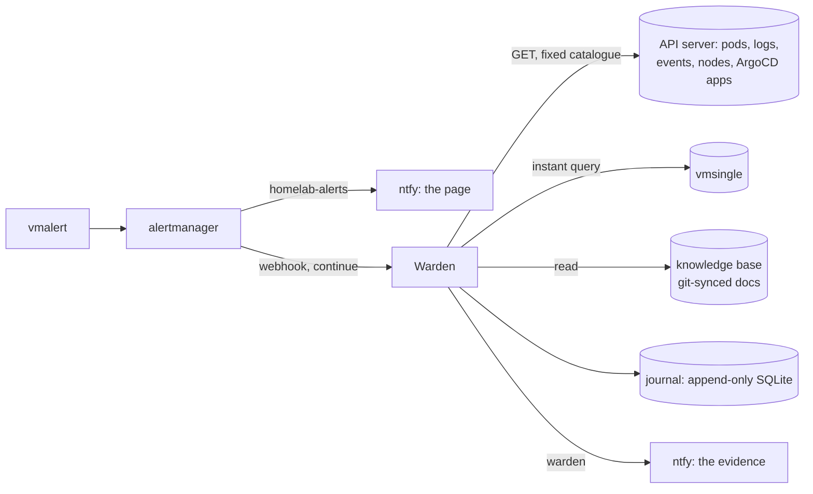

# Warden

An incident-investigation agent for the homelab platform. **It reads the
cluster but never writes to it.** Decision record:
[Homelab ADR 0011](https://github.com/Blacklotus89898/Homelab/blob/main/docs/adr/0011-warden-sre-agent.md).



For each **firing** alert, Warden runs once and collects an evidence bundle.
Collectors run independently, and a failure is recorded without stopping the
rest:

| Collector | What |
|---|---|
| pods | the alert's pod, or the namespace's unhealthy pods: phase, restarts, waiting/terminated reasons |
| logs | last 30 lines of troubled containers; the **previous** instance after a restart (that's where the crash is) |
| events | Warning events in the namespace, last 2h, merged per object+reason |
| argocd | the Applications deploying into the namespace (cluster-wide alert: every app not Synced/Healthy) |
| nodes | the alert's node, plus any node NotReady, cordoned or under pressure |
| metric | the alert's own expression, evaluated now |
| kb | the alert's `runbook_url`, plus the top knowledge-base hits for the alert name, namespace and problem reasons |

The full bundle is journaled. That record is the future eval set. A
redacted, truncated digest goes to ntfy topic `warden`.

## The boundary (pinned by `boundary_test.go`)

- **API access:** `internal/kube` only issues `GET` on five path patterns.
  Secrets, configmaps, exec, attach, proxy and port-forward are refused
  before any request leaves the process. Separately, the ServiceAccount's
  ClusterRole (`warden-read`) grants the same set and nothing more.
- **Tools:** there is no shell, no generic HTTP fetch and no write path.
  Warden's only outputs are its journal and ntfy.
- **Untrusted input:** alert labels, events and logs are all treated as
  untrusted. Everything leaving the journal is redacted, because ntfy is
  unauthenticated on the LAN.
- **Rate limits:** one investigation per firing (deduplicated by
  fingerprint and `startsAt`), one worker, a bounded queue, and a daily cap.
  Every skip is journaled.
- **Off switch:** `WARDEN_ENABLED=false` journals alerts and does nothing
  else.

## API

| | |
|---|---|
| `POST /alerts` | alertmanager webhook (receiver `warden`) |
| `GET /investigations` | recent investigations |
| `GET /investigations/{id}` | one bundle with its journal trail |
| `GET /metrics` | journal events by kind, `warden_enabled` |
| `GET /health` | liveness |

## Configuration

| env | default | |
|---|---|---|
| `WARDEN_ENABLED` | `true` | `false` = journal only |
| `WARDEN_DAILY_CAP` | `40` | investigations per UTC day |
| `WARDEN_NTFY_URL` / `WARDEN_NTFY_TOPIC` | — / `warden` | digest push (empty URL = off) |
| `WARDEN_VM_URL` | `http://vmsingle-vmstack.monitoring.svc:8428` | instant queries |
| `WARDEN_KB_ROOTS` | — | `label=dir,label=dir` (git-synced markdown) |

## Roadmap

These are the ADR 0011 phases: 1a evidence (this) → 1b model summary over
the bundle → 2 replay eval → 3 fixes as PRs → 4 gated live actions →
5 narrow self-approval.

```bash
go test ./...
```
