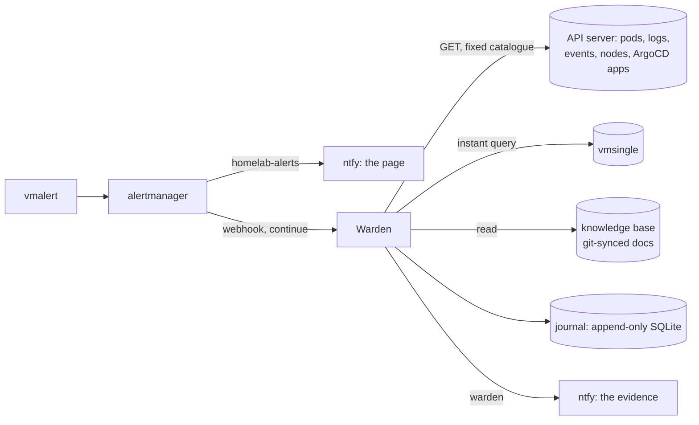

# Warden

An incident-investigation agent for the homelab platform. **It reads the
cluster but never writes to it.** Decision record:
[Homelab ADR 0011](https://github.com/Blacklotus89898/Homelab/blob/main/docs/adr/0011-warden-sre-agent.md).
Deployment: [Homelab `services/warden`](https://github.com/Blacklotus89898/Homelab/tree/main/services/warden).
When it misbehaves: [DaVinci runbook `warden.md`](https://github.com/Blacklotus89898/DaVinci/blob/main/docs/runbooks/warden.md).
Live map: https://warden.lab.home/map (LAN only).



For each **firing** alert, Warden runs once and collects an evidence bundle.
A front-door alert (SLO burn, door down) has a probe URL in `instance`
instead of a namespace. Warden resolves it to the namespace behind the door
the same way the status map does (in-cluster service DNS, then
`WARDEN_MAP_HOSTS`, then namespace or ArgoCD app name), so the namespace
collectors run on the right app. Collectors run independently, and a failure
is recorded without stopping the rest:

| Collector | What |
|---|---|
| pods | the alert's pod, or the namespace's unhealthy pods: phase, restarts, waiting/terminated reasons |
| logs | last 30 lines of troubled containers; the **previous** instance after a restart (that's where the crash is) |
| events | Warning events in the namespace, last 2h, merged per object+reason |
| argocd | the Applications deploying into the namespace (cluster-wide alert: every app not Synced/Healthy) |
| nodes | the alert's node, plus any node NotReady, cordoned or under pressure |
| metric | the alert's own expression, evaluated now (narrowed to the alert's `instance` when it has one) |
| kb | the alert's `runbook_url`, plus the top knowledge-base hits for the alert name, namespace and problem reasons |

The full bundle is journaled. That record is the future eval set. A
redacted, truncated digest goes to ntfy topic `warden`.

## The boundary (pinned by `boundary_test.go`)

- **API access:** `internal/kube` only issues `GET` on five path patterns.
  Secrets, configmaps, exec, attach, proxy and port-forward are refused
  before any request leaves the process. Separately, the ServiceAccount's
  ClusterRole (`warden-read`) grants the same set and nothing more.
- **Tools:** there is no shell, no generic HTTP fetch and no write path.
  Warden's only outputs are its journal and ntfy.
- **Uptime Kuma:** two fixed `GET` paths on its *public* status page
  (`/api/status-page/<slug>` and `.../heartbeat/<slug>`), no credentials.
  It sees exactly what a browser on the LAN sees.
- **Untrusted input:** alert labels, events and logs are all treated as
  untrusted. Everything leaving the journal is redacted, because ntfy is
  unauthenticated on the LAN.
- **Rate limits:** one investigation per firing (deduplicated by
  fingerprint and `startsAt`), one worker, a bounded queue, a daily cap on
  pushes and a daily intake bound of 4x that cap. Every skip is journaled.
- **Off switch:** `WARDEN_ENABLED=false` journals alerts and does nothing
  else. The console's "investigate now" is refused too.
- **Console writes** reach only Warden's own journal: an operator
  investigation (the same read-only collectors, one at a time, ≥10s apart,
  bounded per day like alert intake) and a diagnosis (append-only,
  redacted). They need `Content-Type: application/json`, the
  `X-Warden-Request: 1` header (CSRF) and a signed-in user.
- **Who is signed in** comes only from authentik's signed `X-Authentik-Jwt`,
  verified against the provider's public JWKS (RS256/ES256, expiry, issuer,
  audience). A username header alone is ignored, so neither a LAN client nor
  a pod calling Warden's Service can claim to be someone. One fixed `GET` to
  the JWKS URL, cached.

## Grouping

One outage fires many alerts. The power-outage recovery on 2026-11-05 sent 23
digests in 8 minutes; replayed through these rules, it sends 6. Every alert
is still investigated and journaled, because reads are cheap and the bundles
are the eval set. Only the pushes are grouped:

- **Same namespace within 15 minutes** (or the same alertname, if there is no
  namespace): one push. The later bundles are journaled as `alert.grouped`
  with the id they fold into.
- **Storm:** once 4 digests have gone out within 10 minutes, the next alert
  sends one notice instead, carrying the status map's likely causes. The
  rest are held for 10 minutes.

Grouping state is in memory, so a restart costs at most one extra push.

## Status map

`/map` is a nested graph, like mermaid subgraphs: the Proxmox host box holds
the node boxes, each node holds Platform / Observability / Apps groups, each
group holds the namespaces with pods on that node, and each namespace shows
its ArgoCD apps and one dot per pod. A namespace on two nodes appears in both,
coloured by its pods *on that node*. Front doors sit above the host; arrows
into their namespace are drawn for failing doors and the selection ("show
all links" draws every one). Pods no node will take get their own "not
placed" box. A List view (cards by tier) is one click away. Statuses are
red / amber / green, grey = suspended on purpose, worst first, plus a
"likely causes" banner. A namespace on a NotReady node is red *because of the
node*, so the node is named as the cause and its namespaces are not.
Clicking a box draws its dependency lines and shows why, its ArgoCD apps,
where its pods run and Warden's latest investigation of it.

It reads through the same catalogue as the collectors (nodes, ArgoCD
Applications, per-namespace pods) plus one `probe_success` query, so the
boundary above is unchanged. Proxmox is not observable from inside the
cluster; its box is inferred from the nodes. Like everything in Warden, the
map runs on the worker: when the worker is down, so is the map (the GitHub
heartbeat watchdog covers that case).

## Console

`/console` is where you, the operator, investigate. The gateway puts it
behind authentik; Warden takes who you are from authentik's signed JWT.

- **Investigations:** every bundle, from an alert or started by you, with
  filters (source, namespace, not yet diagnosed). A push on the `warden`
  topic opens its investigation here (`WARDEN_PUBLIC_URL`).
- **One investigation:** the alert, unhealthy pods with their last log
  lines, warning events, ArgoCD, nodes, the alert's metric now, knowledge-base
  hits, the journal trail, and **your diagnosis**: what happened, why, what
  fixed it. Diagnoses are append-only and become phase 2's eval set.
- **Investigate now:** run the collectors on a namespace, pod or node with no
  alert. Nothing is pushed.
- **A namespace:** its signals and Kuma monitors now; **blast radius** from
  observed mesh traffic over 24h (who calls it, what it calls, whether users
  reach it through the gateway, which nodes it runs on); **what changed**
  (ArgoCD deploys and failed syncs, restarts with their reason, warning and
  scaling events, alerts, investigations and diagnoses, newest first, 6h to
  7d); and **traffic** over 1h to 7d (requests by status class, 5xx share,
  p95, CPU and memory against limits, restarts) with a link to Grafana.

Blast radius is observed, not declared: a dependency appears only if traffic
crossed the ambient mesh in the last 24h. Namespaces outside the mesh and
calls leaving the cluster are invisible to it. Warden draws no conclusions:
the console lays the evidence out and you decide.

## Services

`/services` is one row per namespace that ArgoCD deploys, worst first, with
the four golden signals over the last 5 minutes and that service's Uptime
Kuma monitors:

| Signal | Source |
|---|---|
| Traffic | requests/s at the Istio gateway (`istio_requests_total`, reporter=source) |
| Errors | 5xx share of those requests |
| Latency | p95 at the gateway (`istio_request_duration_milliseconds_bucket`) |
| Saturation | the busiest container's CPU and the fullest container's memory, each against its limit |
| Uptime Kuma | per monitor: state, 24h uptime, latest ping, cert days, the last 30 checks |

Traffic, errors and latency exist only for services with a `*.lab.home`
route; the rest show "–". Amber means a paging threshold in Homelab's
`golden-signals-rules.yaml` is getting close (5xx > 10%, p95 > 3s, > 90% of a
limit), and a monitor that is down makes its service red. Nothing is
concluded or acted on: it is evidence for the person investigating.

A monitor joins a namespace by its name: as a front-door host
(`kavita.lab.home`), as a namespace or app name (`Sealed Secrets` →
`sealed-secrets`), or through `WARDEN_KUMA_MAP`. Monitors that join nothing
(the Proxmox host, LXCs, the router) are listed under "Outside the cluster",
grouped as on the Kuma status page.

## API

| | |
|---|---|
| `POST /alerts` | alertmanager webhook (receiver `warden`) |
| `GET /investigations` | recent investigations |
| `GET /investigations/{id}` | one bundle with its journal trail |
| `GET /map` | the status map page: host → nodes → platform → observability → apps → front doors |
| `GET /map.json` | the data behind it (rebuilt at most every 15s) |
| `GET /console` | the operator console (behind authentik at the gateway) |
| `GET /console/api/investigations[/{id}]` | investigations with source and diagnosis state; one bundle with its trail and diagnoses |
| `POST /console/api/investigate` | `{"namespace","pod","node"}`: run the collectors now (journal only, no push) |
| `POST /console/api/investigations/{id}/diagnosis` | `{"text"}`: append your diagnosis |
| `GET /console/api/namespaces/{ns}/timeline?hours=` | what changed (default 24h, max 7d) |
| `GET /console/api/namespaces/{ns}/traffic?range=` | `1h`, `6h`, `24h` or `7d` |
| `GET /console/api/namespaces/{ns}/blast` | observed callers and callees over 24h |
| `GET /services` | the services page: golden signals + Uptime Kuma per namespace |
| `GET /services.json` | the data behind it (rebuilt at most every 30s) |
| `GET /metrics` | journal events by kind, `warden_enabled` |
| `GET /health` | liveness |

## Configuration

| env | default | |
|---|---|---|
| `WARDEN_ENABLED` | `true` | `false` = journal only |
| `WARDEN_DAILY_CAP` | `40` | pushes per UTC day; intake (investigations) is bounded at 4x |
| `WARDEN_NTFY_URL` / `WARDEN_NTFY_TOPIC` | — / `warden` | digest push (empty URL = off) |
| `WARDEN_VM_URL` | `http://vmsingle-vmstack.monitoring.svc:8428` | instant queries |
| `WARDEN_KB_ROOTS` | — | `label=dir,label=dir` (git-synced markdown) |
| `WARDEN_KUMA_URL` / `WARDEN_KUMA_SLUG` | `http://uptime-kuma.monitoring.svc:3001` / `homelab` | public status page read by `/services` (`off` = no monitors) |
| `WARDEN_KUMA_MAP` | — | `Monitor name=namespace;…` for monitors whose name resolves to no namespace (`VictoriaMetrics=monitoring`). `;`-separated because names can hold commas |
| `WARDEN_PUBLIC_URL` | — | where the console is reached (`https://warden.lab.home`); pushes link to their investigation |
| `WARDEN_AUTH_JWKS_URL` | — | authentik provider JWKS (`http://authentik.default.svc:9000/application/o/<slug>/jwks/`). Set in production: the console user then comes only from a verified `X-Authentik-Jwt` |
| `WARDEN_AUTH_ISSUER` / `WARDEN_AUTH_AUDIENCE` | — | optional exact `iss`, and the provider's client ID required in `aud` |
| `WARDEN_USER_HEADER` | `X-Authentik-Username` | **development only**, used when no JWKS is set: the header is trusted as-is. Every console API call requires a user either way, so a missing gateway policy fails closed
| `WARDEN_MAP_HOSTS` | — | `label=namespace,…` for front-door hosts whose first label isn't a namespace or app name (`grafana=monitoring`). Used by both the map and front-door investigations |

## Roadmap

These are the ADR 0011 phases: 1a evidence (this) → 1b model summary over
the bundle → 2 replay eval → 3 fixes as PRs → 4 gated live actions →
5 narrow self-approval. **On hold from 1b (2026-11-24):** no model step for
now. The operator investigates and approves; Warden gathers and presents
evidence.

```bash
go test ./...
```
